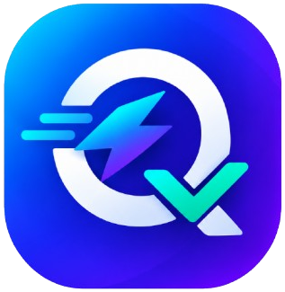

<p align="center">
  <a href="https://quickkaj.com">
    
  </a>
</p>

<h1 align="center">Quickkaj — কুইককাজ</h1>

<p align="center">
  <strong>স্মার্ট ক্যারিয়ার, নাগরিক সেবা ও ১৮+ ফ্রি ডিজিটাল অনলাইন টুলস হাব</strong><br>
  <em>All-in-One Digital Utilities, Citizen Services & Career Portal for Bangladesh</em>
</p>

<p align="center">
  
  
  
  
  
</p>

---

## 🌟 পরিচিতি (About Quickkaj)

**Quickkaj (কুইককাজ)** হলো একটি আধুনিক, দ্রুতগতির অল-ইন-ওয়ান ডিজিটাল প্ল্যাটফর্ম। চাকরিপ্রার্থী, শিক্ষার্থী, ফ্রিল্যান্সার ও সাধারণ মানুষের দৈনন্দিন প্রয়োজনীয় অনলাইন কাজগুলোকে সহজ, ঝামেলাহীন এবং নিরাপদ করতে এটি তৈরি করা হয়েছে।

এই প্ল্যাটফর্মে ১৮টির বেশি অত্যাধুনিক ব্রাউজার-সাইড টুলস, সরকারি ও বেসরকারি চাকরির সঠিক সার্কুলার, বাংলাদেশের নাগরিক সেবা গাইডলাইন এবং এডুকেশন বোর্ড রেজাল্ট ট্র্যাকার এক জায়গায় পাওয়া যায়।

---

## ✨ প্রধান ফিচারসমূহ (Key Features)

### 💼 ১. চাকরি ও ক্যারিয়ার হাব (Career & Jobs)
- **সরকারি ও বেসরকারি সার্কুলার:** বিসিএস, ব্যাংক, শিক্ষক নিয়োগ ও শীর্ষ কর্পোরেট চাকরির নিয়মিত হালনাগাদ তথ্য।
- **ফিল্টারিং ও বুকমার্কিং:** ক্যাটাগরি, অবস্থান ও শিক্ষাগত যোগ্যতা অনুযায়ী ফিল্টার এবং সেভ করে রাখার সুবিধা।
- **জব অ্যালার্ট ও সাবস্ক্রিপশন:** নতুন সার্কুলার প্রকাশ হলে ইমেইলে নোটিফিকেশন পাওয়ার ব্যবস্থা।
- **অ্যাডমিন এক্সপোর্ট:** সাবস্ক্রাইবারদের তালিকা এক ক্লিকেই CSV আকারে ডাউনলোড।

### 🏛️ ২. নাগরিক সেবা ও রেজাল্ট হাব (Citizen Services & Results)
- **বোর্ড পরীক্ষার রেজাল্ট ট্র্যাকার:** এসএসসি, এইচএসসি ও জাতীয় বিশ্ববিদ্যালয়ের রেজাল্ট ও এসএমএস (SMS) কোড গাইড।
- **ই-পাসপোর্ট গাইড ২০২৬:** ৫ ও ১০ বছর মেয়াদি ৪৮ ও ৬৪ পৃষ্ঠার সরকারি ফি তালিকা এবং আবেদন নির্দেশিকা।
- **এনআইডি ও জন্ম নিবন্ধন:** জাতীয় পরিচয়পত্র সংশোধন ফি ও জন্ম সনদ অনলাইন যাচাই নির্দেশিকা।
- **রেডিমেড দরখাস্ত ও জিডি ড্রাফট:** পাসপোর্ট/সার্টিফিকেট হারানোর জিডি ফরম্যাট ও বিভিন্ন নাগরিক আবেদনপত্র (১-ক্লিক কপি ও প্রিন্ট)।

### 🛠️ ৩. ১৮+ গোপনীয়তাবান্ধব ডিজিটাল টুলস (Client-Side Privacy Tools)
- **ফ্রি CV বিল্ডার:** আকর্ষণীয় প্রফেশনাল কারিকুলাম ভিটা (CV) তৈরি ও PDF ডাউনলোড।
- **পিডিএফ টুলস স্যুট:** PDF ফাইল মার্জ, স্প্লিট, পেজ রোটেট ও রূপান্তর (১০০% ডিভাইসে প্রসেস হয়, সার্ভারে আপলোড হয় না)।
- **ছবি রিসাইজার (৩০০×৩০০):** সরকারি চাকরি ও টেলিটক আবেদনের জন্য ৩০০×৩০০ ফটো এবং ৩০০×৮০ স্বাক্ষর রিসাইজার।
- **ব্যাকগ্রাউন্ড রিমুভার:** কৃত্রিম বুদ্ধিমত্তা (AI) দিয়ে ছবির ব্যাকগ্রাউন্ড অপসারণ।
- **ইউটিলিটি ক্যালকুলেটর:** বয়স ক্যালকুলেটর, বিশ্ববিদ্যালয় সিজিপিএ (CGPA) ক্যালকুলেটর, শব্দ গণনাকারী ও কেস কনভার্টার।
- **URL শর্টেনার ও QR জেনারেটর:** বড় লিংক ছোট করা এবং কাস্টম QR কোড তৈরি।

### 🛡️ ৪. শক্তিশালী অ্যাডমিন প্যানেল (Admin Panel)
- **ইনবক্স ও কন্টাক্ট সাপোর্ট:** ব্যবহারকারীদের পাঠানো মেসেজ সরাসরি দেখা এবং ইমেইলে রিপ্লাই দেওয়ার সুবিধা।
- **অ্যানালিটিক্স ড্যাশবোর্ড:** রিয়েল-টাইম পেজভিউ ও ট্রাফিক ট্র্যাকিং।
- **অ্যাড প্লেসমেন্ট কন্ট্রোল:** Adsterra ব্যানার ও পপ-আন্ডার কোড ড্যাশবোর্ড থেকেই চালু/বন্ধ করার সুবিধা।

### 🌐 ৫. পূর্ণাঙ্গ দ্বিভাষিক সাপোর্ট (Bilingual: বাংলা ও English)
- এক ক্লিকেই সম্পূর্ণ সাইট বাংলা (`/bn`) অথবা ইংরেজিতে (`/en`) ব্রাউজ করার সুবিধা।

---

## 🚀 টেকনোলজি স্ট্যাক (Tech Stack)

- **ব্যাকএন্ড:** [Laravel 11.x](https://laravel.com/) (PHP 8.3+)
- **ডাটাবেস:** MySQL 8.x / MariaDB
- **ফ্রন্টএন্ড ও ডিজাইন:** Blade Engine, Vanilla Tailwind CSS, Font Awesome 6
- **অ্যাসেট বান্ডলার:** [Vite](https://vitejs.dev/)
- **টেস্টিং ফ্রেমওয়ার্ক:** PHPUnit (63 Feature & Unit Tests, 100% Passing)
- **কোড কোয়ালিটি:** Laravel Pint

---

## 💻 লোকাল কম্পিউটারে রান করার নিয়ম (Local Installation)

১. **রিপোজিটরি ক্লোন করুন:**
```bash
git clone https://github.com/git-sajib/quickkaj.git
cd quickkaj
```

২. **কম্পোজার ডিপেনডেন্সি ইনস্টল করুন:**
```bash
composer install
```

৩. **এনভায়রনমেন্ট ফাইল সেটআপ করুন:**
```bash
cp .env.example .env
php artisan key:generate
```

৪. **ডাটাবেস কনফিগার করুন:**
`.env` ফাইলে আপনার MySQL ডাটাবেসের তথ্য দিন:
```env
DB_CONNECTION=mysql
DB_HOST=127.0.0.1
DB_PORT=3306
DB_DATABASE=quickkaj
DB_USERNAME=root
DB_PASSWORD=
```

৫. **মাইগ্রেশন ও ডিফল্ট ডাটা সিড চালান:**
```bash
php artisan migrate --seed
```

৬. **স্টোরেজ লিংক ও ফ্রন্টএন্ড বিল্ড:**
```bash
php artisan storage:link
npm install
npm run build
```

৭. **লোকাল সার্ভার চালু করুন:**
```bash
php artisan serve
```
এখন ব্রাউজারে `http://127.0.0.1:8000` ভিজিট করুন।

---

## 🔑 ডিফল্ট অ্যাডমিন ক্রেডেনশিয়াল (Default Admin Login)

* **ইউআরএল:** `http://127.0.0.1:8000/login`
* **ইমেইল:** `admin@quickkaj.com`
* **পাসওয়ার্ড:** `Admin@123!`

*(প্রোডাকশন সার্ভারে ডিপ্লয় করার পর অ্যাডমিন ড্যাশবোর্ড থেকে পাসওয়ার্ড পরিবর্তন করে নিন)*

---

## 🧪 টেস্ট রান করা (Running Tests)

সম্পূর্ণ টেস্ট স্যুট চালাতে:
```bash
php artisan test --compact
```
*(বর্তমানে ৬৩টি টেস্ট ও ১৯৭টি অ্যাসার্শন ১০০% সফলভাবে পাস করা)*

---

## 📄 লাইসেন্স (License)

এই প্রজেক্টটি ওপেন সোর্স এবং [MIT License](LICENSE) এর আওতাভুক্ত।
